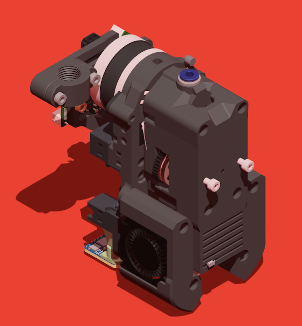

# chimera-toolchanger
A tool changing system for Klipper based printers.

### Current State
pre-Alpha/Alpha
Changing and calibration work, supporting infrastructure is needed for reliable printer i.e. nozzle guards on the docks and tool sensing.

## The Idea
I want a toolchanger that changes the filament path without changing the entire toolhead. I also want to throw this on an existing 2.4 without losing a large amount of print volume. There's a lot of great projects that are either in active development or some stage of published but I wanted something slightly different. This specific project is an attempt to take the things i like and mash them together hence the "chimera" name. This is not a condemnation of those projects and whatever components they use (I'll likely build some of those projects in the future) but rather an experimentation to see where some other ideas can lead.

I'd like to mention a few inspirations here:
* [The Medusa HC project](https://github.com/Irbis3D/MedusaHC)
* The A4T-C project (one of the voron usermods mixtape channels in their discord)
* [The Blackbox toolchanger](https://blackbox3d.xyz)
* Armored Turtle and their preview of the ["teased" armored turtle changer](https://youtu.be/wiunEjQLO7o?si=8A-k8uzNSUXgyrMH&t=1113)
* [CXChanger](https://github.com/WheelsTheCat/CxChanger) (English translation)
* Discord user ycsy in the A4T-C channel as his Maxwell coupling was remixed for this project

Many systems are attempting this style of toolchanger using different mechanisms. I'm seeing the opening of extruder gears and the use of pins for alignment as common approaches. Some extruder opening systems leverage toolhead motion (relying on x and y motors), a servo, or even engaging the extruder gears to pry open the mechanism. These aren't bad ideas but I wanted to approach a system that's simpler. I took some time to look at the Flashforge Creator 5, the Blackbox, and even the "teased" armored turtle changer (ATC) as they all swap gearsets along with the hotend. This adds an additional cost per tool but allows a simpler changing mechanism if done correctly. There's no leverage that is needed to open the extruder and you don't have to worry about skipped steps or burning out a servo. This project uses a carriage mounted motor with a 17 tooth bondtech motor gear that meshes with a set of hgx v2 gears attached to the hotend, similar to the ATC and Blackbox projects. Additionally it uses a maxwell coupling (derived from user ycsy in the A4T-C project channel and cxchanger) to achieve repeatable coupling. My thoughts around the maxwell coupling in this scenario are that it gives to tool more wiggle before gear engagement to get it seated correctly. 

Testing the mechanism has shown promise and I'm beefing up the system to verify reliability. Excessive flow would normally cause the extruder to skip but in this case causes the maxwell coupling to unseat. Flow seems to easily handle 18 to 20 mm3/s but I need to test to confirm if this is limited by the coupling or by the max flow of my hotends (cheap x1 clones).

## Toolhead
The toolhead carries the part fans and extruder motor in addition to a tool detection sensor. The motor requires a 5mm shaft for a bond tech-style 17 tooth motor gear that was part of the big gear sets before the smaller nematodes 14 motors with an integrated gear became common. The part cooling fans were designed to be modular and prioritized footprint over capability to try and keep the size of tools minimal. For this reason 3010 blower fans are used. The LDO fans meant for the jabberwocky project provide high static pressure and perform well here. Future fan designs may be adapted but there are other priorities at the time of writing. The Maxwell coupling side on the toolhead uses 6 2x10mm pins and an additional 6 6x3mm round magnets. The detection sensor uses a standard microswith (with metal lever) in the toolhead and locked in place with 2 m2x10 self tapping screw

The toolhead is designed around the xol carriage though adapting to a standard stealth burner carriage shouldn't be difficult. Testing has been conducted with the standard xol cartographer probe mount though any options that work with xol should work.

Notes:
* The toolhead's motor gear can also be used with the Blackbox project's [IGUS SLS printed motor gear](https://kb-3d.com/store/motion-system/31-blackbox-igus-sls-extruder-drive-gear-1634506563098.html). This might help with longevity as it's meant to seat into a gear where the stock bondtech motor gear was not designed around that constraint. Further testing is needed

* The 3010's fan ducts have undergone basic CFD analysis to confirm air is going under the nozzle but further optimization will eventually be done. The fan ducts are modular for this purpose to avoid reprinting large parts after optimizing fans. 

## Tools
A tool is composed of a set of hgx v2 gears in a fixed arrangement (no tensioning) with a Bambu X1 style hotend. While a set of gears and a hotend are needed for each tool these can be regularly found for $15 or less each so the cost can be minimized as long as engineering hotends aren't used. A goal here was to be able to mix and match X1 style hotends with a few nice ones and a few cheap ones if desired. A 2510 hotend fan is also used per tool to cool the heatbreak. The maxwell portion of the tool uses 3 4x6mm rounded pins (6mm total length with an approximately 2mm fillet on one end) to interface with the pins on the toolhead carriage. A set of 6 3x6mm magnets attracts it to the toolhead.

The front of each tool has a cover that contains the screws used for docking a tool and a hollow space to manage wires.

Notes:
* The gears are fixed as there's no room for a tensioning mechanism. I'm playing with different gear spacing to hopefully eventually have a set that can be dedicated for flexibles or other uses.

## Docks
As I'm prototyping on a 2.4 the current dock is designed to use z motion to lift the tool up and lower it into the cradle then move backwards in y to disengage. I'm also using a 1515 bar across the top of the printer as I have one available that was to be used for another tool changing system. 

Notes:
* This can be easily adopted to an XY only docking system but my printers with a fixed gantry are occupied and I'm not interested in disassembling them. I will most likely create something for a trident if this project continues but I have none to prototype on so I will work from CAD only.

* The dock will eventually incorporate a switch to detect which tools are present and be able to initialize to any tool.

## 

## BOM
`incomplete`
* 4x6 rounded pins - 3 per tool
* 2x10mm pins - 6
* 3x6mm round magnets (n52 preferred) - 6 for toolhead, 6 more per tool, 1 more per dock
* HGX V2 gears - 1 per tool
* X1 style hotend - 1 per tool
* 17 tooth motor gear (bondtech)
* Nema 14 motor with a 5mm shaft
* PG7 cable gland (used in toolboard mount)
* Various M3 bolts
* M3 countersunk 10mm bolts for docking points - 2 per toolhead
* 2 3010 blower fans for cooling

## Assembly
TODO

The cad will be provided to reference for assembly. I recommend placing the magnets in alternating polarity to provide the strongest connection and alignment forces.

## Software
TODO

This work is licensed under a
[Creative Commons Attribution-NonCommercial-ShareAlike 4.0 International License][cc-by-nc-sa].

[![CC BY-NC-SA 4.0][cc-by-nc-sa-image]][cc-by-nc-sa]

[cc-by-nc-sa]: http://creativecommons.org/licenses/by-nc-sa/4.0/
[cc-by-nc-sa-image]: https://licensebuttons.net/l/by-nc-sa/4.0/88x31.png
[cc-by-nc-sa-shield]: https://img.shields.io/badge/License-CC%20BY--NC--SA%204.0-lightgrey.svg
